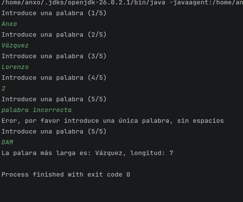

# Tarea 27

## Asignatura

- PSP

## Alumno

- Anxo Vázquez Lorenzo (2DAM)

## Servidor

El servidor consta de un método `main` que espera a recibir datos de un cliente en un bucle infinito, una vez recibe un dato de un cliente primero lo convierte a `String` e imprime un `LOG` en el servidor con la fecha, hora, IP, puerto de cliente y el mensaje completo, después usando el método `getPalabraLarga()` secciona la palabra por espacios y se devuelve la palabra más larga encontrada, por último se envía al cliente la palabra más larga con su longitud.

```java
public static void main(String[] args) throws IOException {
        try (DatagramSocket socket = new DatagramSocket(PUERTO)) {
            byte[] buffer = new byte[BUFFER_TAMANHO];
            while (true) {
                DatagramPacket recibido = new DatagramPacket(buffer, buffer.length);
                socket.receive(recibido); // Bloquea
                String texto = new String(recibido.getData(), 0,
                        recibido.getLength(), StandardCharsets.UTF_8); //lo convierte de nuevo a texto
                System.out.println("[LOG] " + getHora() + " " + recibido.getAddress().toString().substring(1) + ":" + recibido.getPort() + " - mensaje recibido: " + texto);
                byte[] resp = ("La palara más larga es: " + getPalabraLarga(texto) + ", longitud: " + getPalabraLarga(texto).length()).getBytes(StandardCharsets.UTF_8);
                socket.send(new DatagramPacket(resp, resp.length,
                        recibido.getAddress(), recibido.getPort())); // le envía la respuesta al cliente
            }
        }
    }
```

## Cliente

El cliente manda 5 palabras en una única cadena de texto separadas por espacios y reintenta la conexión la cantidad de veces que vengan definidas en la constante `MAX_INTENTOS`. Esta clase tiene dos métodos; un `main` que pide palabras y las mete en una lista que se la pasa al segundo método (`enviarYrecibir`) que envía las palabras de la lista separadas por un espacio al servidor y espera a la respuesta para imprimirla.

```java
public static void enviarYrecibir(List<String> lista) throws IOException{
        String envio = ""; //el texto que se va a enviar -> palabra1 palabra2 palabra3 palabra4 palabra5
        try(DatagramSocket socket = new DatagramSocket()) {
            socket.setSoTimeout(TIMEOUT);
            InetAddress servidor = InetAddress.getByName("localhost");

            for (String palabra : lista) {
                envio = envio + palabra + " ";
            }
            byte[] datos = envio.getBytes(StandardCharsets.UTF_8);

            //ENVÍO
            socket.send(new DatagramPacket(datos, datos.length, servidor, Servidor.PUERTO));
            byte[] buffer = new byte[BUFFER_TAMANHO];
            DatagramPacket respuesta = new DatagramPacket(buffer, buffer.length);

            //RESPUESTA
            for(int i =1; i<=MAX_INTENTOS;i++) { //realiza los intentos
                try {
                    socket.receive(respuesta);
                    System.out.println(new String(buffer, 0, respuesta.getLength(), StandardCharsets.UTF_8));
                    break; //sale del bucle una vez recibida la respuesta
                } catch (SocketTimeoutException e) {
                    System.out.println("Sin respuesta: " + e.getMessage());
                    if(i==MAX_INTENTOS){
                        System.out.println("Máximo de intentos superados");
                    }
                }
            }
        }
    }
```

## Ejecución



El log del servidor:

```
[LOG] 24/11/2026-10:29:34 127.0.0.1:34586 - mensaje recibido: Anxo Vázquez Lorenzo 2 DAM 
```

## Bibliografía y uso de IA

- GeeksforGeeks - Día y Hora

  https://www.geeksforgeeks.org/java/localtime-gethour-method-in-java-with-examples/

- Oracle Documentación - DatagramSocket

  https://docs.oracle.com/javase/8/docs/api/java/net/DatagramSocket.html

> No he necesitado IA para esta tarea